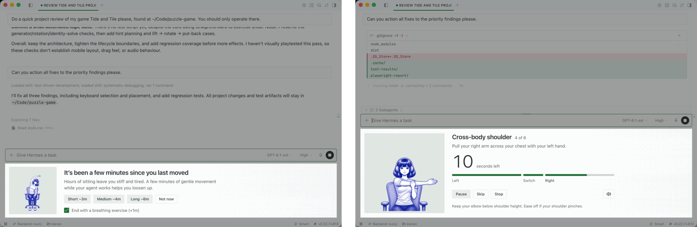

# OpenChi

Guided desk stretches and breathing breaks for [Hermes Desktop](https://hermes-agent.nousresearch.com), offered while your agent works.

When your agent takes on a long task, a card below the input box offers a few minutes of stretches at your desk. The sessions end with an eye exercise and optionally a minute of breathing. Nothing starts until you click, and once you take a break or turn one down, OpenChi waits 20 minutes before it offers another.

To start a break yourself, open the command palette (⌘K) and run **OpenChi: Start stretch session** or **OpenChi: Start breathing session**.

To change the timings, mute the sound or turn the offers off, go to **Settings → Plugins → OpenChi**.



## Install

```bash
hermes plugins install openchi
```

Or from GitHub:

```bash
hermes plugins install imkieransmith/openchi
```

Then open Hermes Desktop, go to **Capabilities → Plugins** and switch **OpenChi** on. OpenChi needs Hermes 0.22.7 or later.

## Privacy

OpenChi runs on your computer and makes no network requests.

To spot tension, it reads each message you send from the input box. It keeps only a score and the time, in memory, for ten minutes, and never stores, sends or changes your text. To stop it reading your messages, turn off **Offer a breather when things get tense**. The code that reads them is in [`src/controller/tension-watch.js`](src/controller/tension-watch.js) and [`src/tension.js`](src/tension.js).

It saves your settings and four times in Hermes's plugin storage: your last break, your last breather, when you started working and when Hermes was last busy.

## Safety

The exercises are gentle, and each one comes with its own safety line. Stop if anything hurts. If you're recovering from an injury or surgery, check with your doctor first.

OpenChi is not medical advice. [SOURCES.md](SOURCES.md) lists the evidence behind what the card says and each exercise, and which choices are our own.

## Development

You need Hermes Desktop and Node 22 or later.

```bash
npm install
scripts/link.sh    # link this checkout into ~/.hermes/plugins/openchi
npm run dev        # rebuild desktop/plugin.js on every save
npm run check      # build, syntax check and tests
```

In Hermes Desktop, open **Capabilities → Plugins**, click **Rescan** and switch **OpenChi** on. Hermes reloads the plugin whenever the build changes. To unlink, run `scripts/link.sh --unlink`.

[AGENTS.md](AGENTS.md) covers how the code fits together.

## License

MIT.
